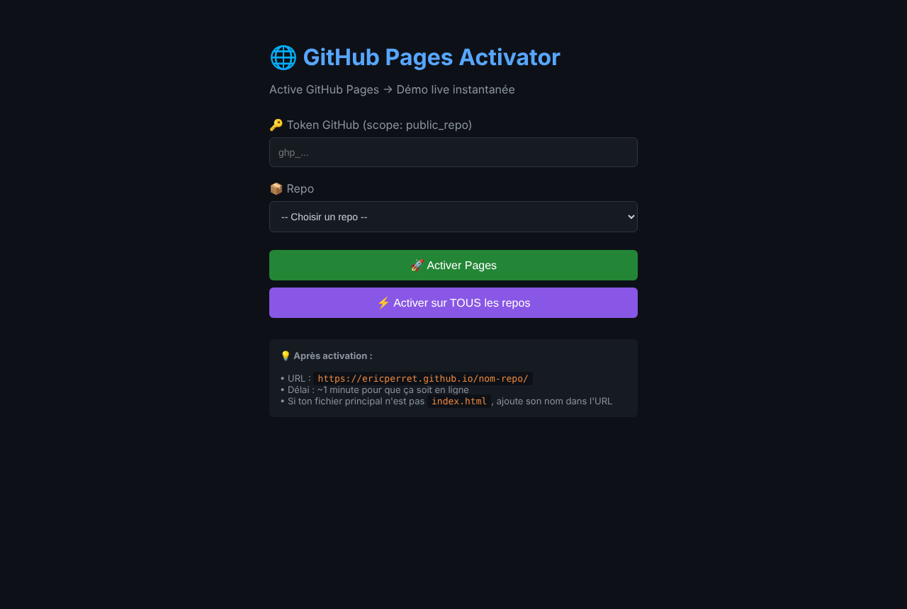

<!--
  Name     : README.md
  Purpose  : Overview of the policy repository (Android privacy policies and GitHub tools)
  Author   : Eric PERRET
  Date     : 2026-10-17
  License  : GPL v3
-->

# 🔏 Policy

🇫🇷 [Version française : LISEZMOI.md](LISEZMOI.md)

This repository hosts, through GitHub Pages, the privacy policies of my Android apps (public addresses declared in the app store listings), the matching APK files, and four small tools to manage my GitHub repositories. Pages in French (SUN NORTH SAT policy: multilingual).

> The policy page names must not change: their addresses are referenced by the app listings.

## Privacy policies

| App | Page | Screenshot |
|---|---|---|
| SUN NORTH SAT & HD QRA Finder | ▶️ [policy.html](https://ericperret.github.io/policy/policy.html) | [view](captures/policy.png) |
| Morse Flash Light RX/TX | ▶️ [policy-cw.html](https://ericperret.github.io/policy/policy-cw.html) | [view](captures/policy-cw.png) |
| Mini Puzzle | ▶️ [puzzle.html](https://ericperret.github.io/policy/puzzle.html) | [view](captures/puzzle.png) |
| SSTV TX Robot 36 | ▶️ [sstv_privacy_policy.html](https://ericperret.github.io/policy/sstv_privacy_policy.html) | [view](captures/sstv_privacy_policy.png) |

## Android apps (APK)

| File | App |
|---|---|
| `app-release.apk-sun` | SUN NORTH SAT & HD QRA Finder |
| `app-release.apk-sstv` | SSTV TX Robot 36 |
| `app-release.apk-minipuzzle` | Mini Puzzle |
| `app-release.apk` | release build without suffix |

To install a suffixed APK, rename it to `.apk` after download.

## GitHub tools

| Tool | Launch | Purpose |
|---|---|---|
| GitHub Pages Activator | ▶️ [github-pages-activator.html](https://ericperret.github.io/policy/github-pages-activator.html) | Enable GitHub Pages on one repository, or on all |
| GitHub Topics Updater | ▶️ [github-topics-updater.html](https://ericperret.github.io/policy/github-topics-updater.html) | Update the topics and descriptions of the repositories |
| Index Generator | ▶️ [index-generator.html](https://ericperret.github.io/policy/index-generator.html) | Scan a repository and generate an `index.html` listing its HTML pages |
| README Injector | ▶️ [readme-injector.html](https://ericperret.github.io/policy/readme-injector.html) | Upload a file (README…) to a chosen repository |

These tools call the GitHub API directly from the browser with a personal token (`public_repo` scope) entered on the page: the token is sent only to the GitHub API. Revoke it after use.

## Deployment

GitHub Pages is published by the `.github/workflows/static.yml` workflow on every push to `main`.

## History

| Version | Change |
|---|---|
| 2026-10-17 | `readme-injector (3).html` renamed `readme-injector.html`, header blocks, README / LISEZMOI created, screenshots |

## License

[GPL v3](LICENSE)

## Author

**Eric PERRET** — [GitHub](https://github.com/ericperret)
